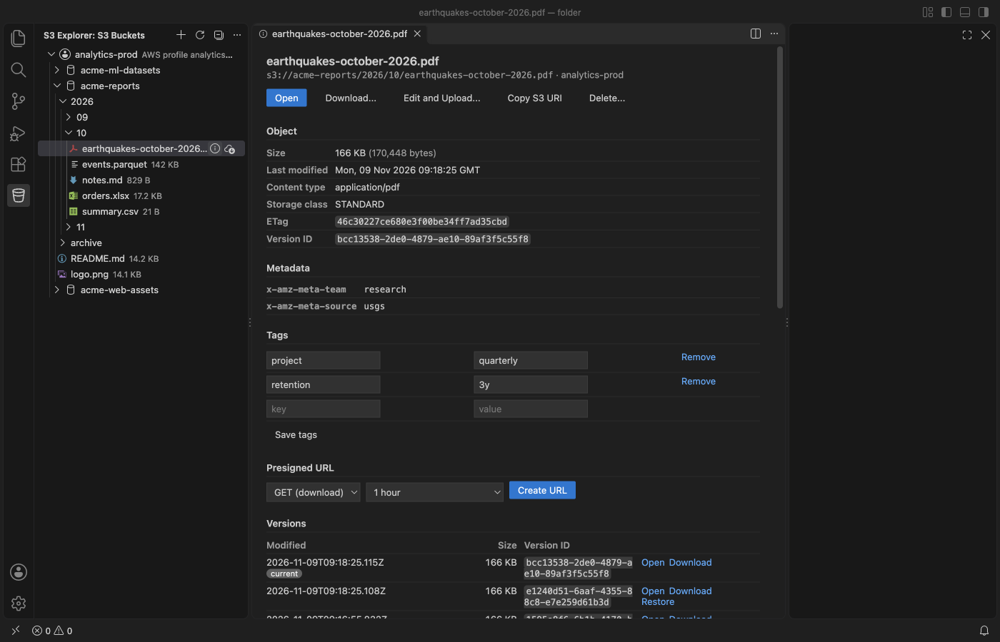

# S3 Explorer & S3 Client, Bucket Browser for AWS, MinIO and Cloudflare R2

Browse S3 buckets in VS Code, open objects in an editor tab, and upload, download or sync files. Works with AWS S3 (profiles from `~/.aws`, SSO profiles too), MinIO, Cloudflare R2, Backblaze B2, Wasabi and DigitalOcean Spaces. Free, no sign-in, no telemetry. It connects only to the storage endpoints you add.

## What it does

- Browse big buckets. Keys load 1,000 at a time with a "Load 1,000 more" row, so a bucket with 1,000,000 keys shows its first page in well under a second. Find a key by prefix as you type, or filter the tree to a prefix.
- Open objects. Text opens read-only in a normal editor tab. PDFs, spreadsheets, Parquet, images and other binary files open in the matching viewer. A 30 MB log asks first, then shows the first 1 MB with one range request.
- Edit and upload. Edit a copy and save. A dialog shows the bucket, key and both sizes before the object is replaced, and warns you if someone changed it on the server since you opened it.
- Upload and download. Drag files or folders from the Explorer onto a bucket. Files of 16 MB or more upload in parts, with progress and Cancel. A stopped upload (even a killed VS Code) resumes and sends only the missing parts. Downloads keep the folder structure, and a key like `../../.ssh/config` never writes outside the folder you chose.
- Copy, move, rename, delete. Works on many objects and whole folders. Every delete and every overwrite lists the keys and asks first.
- Details. Metadata, content type, storage class, ETag, tags (edit and save), versions (open, download, restore) and presigned URLs for GET or PUT, from 15 minutes to 7 days.
- Sync a folder with a prefix, in either direction. You see a dry-run plan (new, changed, to delete) before anything changes.

## Connections

| Where | How |
|---|---|
| AWS, profile | Pick a profile from `~/.aws/config` and `~/.aws/credentials`: access keys, `credential_process`, roles with `source_profile`, and SSO profiles after `aws sso login` (no browser callback in VS Code). `endpoint_url` in a profile is honored. |
| AWS, access key | Access key ID and secret, plus a region. |
| Cloudflare R2 | Account ID and an R2 API token's access key. |
| MinIO and other S3-compatible services | Endpoint URL, region, path-style or virtual-hosted URLs, and an option to accept a self-signed certificate. |
| Backblaze B2, Wasabi, DigitalOcean Spaces | Region and access key. |
| Environment variables | `AWS_ACCESS_KEY_ID` and `AWS_SECRET_ACCESS_KEY` from the environment of VS Code. Used only if you add this connection. |

Keys you type go to the OS keychain through VS Code SecretStorage, never into settings files. Profile names in `~/.aws` are listed so you can connect in one click. Nothing connects, and no profile's keys are read, until you pick it. The `default` profile is never used on its own, and neither is `AWS_PROFILE`.

A key that may not list buckets (common for R2 tokens and scoped IAM users) can still browse: choose Add Bucket by Name.

## Why this one

These are open requests and reviews about the most installed AWS extension for VS Code. Each row was checked in a real VS Code with this release (see "How it was tested").

| Request or review | Link | Here |
|---|---|---|
| Upload folders | [aws-toolkit-vscode #1931](https://github.com/aws/aws-toolkit-vscode/issues/1931) | Drag a folder or use Upload Folder; sync uploads a folder with a plan first |
| Delete multiple files, objects or folders | [#3008](https://github.com/aws/aws-toolkit-vscode/issues/3008) | Multi-select delete and folder delete, with the keys listed first |
| Rename files in S3 | [#4588](https://github.com/aws/aws-toolkit-vscode/issues/4588) | Rename objects and folders (copy and delete, confirmed) |
| Search by prefix, filter object names | [#6049](https://github.com/aws/aws-toolkit-vscode/issues/6049), [#8352](https://github.com/aws/aws-toolkit-vscode/issues/8352) | Find by prefix as you type; filter the tree. On 1,000,000 keys the gate measured the filter and search in milliseconds |
| View bucket contents without ListBuckets | [#1793](https://github.com/aws/aws-toolkit-vscode/issues/1793) | Add Bucket by Name |
| Presigned upload (PUT) URL | [#2635](https://github.com/aws/aws-toolkit-vscode/issues/2635) | Presigned GET and PUT, chosen expiry |
| Changing the profile does not reload the buckets | [#7789](https://github.com/aws/aws-toolkit-vscode/issues/7789), [#8739](https://github.com/aws/aws-toolkit-vscode/issues/8739) | Each profile or endpoint is its own connection, side by side |
| "Extremely slow, takes ages to connect" and SSO login with an "invalid callback URL" (Marketplace reviews, March 2025 and June 2024) | [Marketplace reviews](https://marketplace.visualstudio.com/items?itemName=AmazonWebServices.aws-toolkit-vscode&ssr=false#review-details) | Lists only what you expand, 1,000 keys per request; SSO reuses the token of `aws sso login` |

That extension covers many AWS services; this one does S3 and S3-compatible storage only. It is not made by or affiliated with Amazon Web Services.

## Large files and safety

- Multipart uploads: 8 MB parts (more for huge files, at most 10,000 parts), 4 at a time. The gate killed VS Code during a 5 GB upload. After the restart, Resume sent only the missing parts, and every part's MD5 on the server matched the local file.
- Memory stays flat: one part per worker, and downloads are streamed to disk.
- Downloads never leave the target folder: keys with `..` segments, drive letters or NUL bytes are skipped and listed. Windows-unsafe characters are replaced.
- Requests that get no answer stop after 30 seconds (setting) with a message that names the host.
- A bucket in another region is found with one redirect.
- Opened objects are read-only. An edit in that tab can never reach the bucket. Only Edit and Upload writes, after a confirmation.

## Free and Pro

Browsing, opening, editing, upload, download, copy, move, rename, delete, versions, tags, presigned URLs and folder sync are free, with no limits.

Zovo Pro adds 3 extras, each with 3 free tries: scheduled sync (runs a sync again every few minutes while VS Code is open, never deletes), copy between two connections (for example AWS to R2), and the size and cost report per folder and storage class. Zovo Pro is USD 19 once on GitHub Sponsors (the ["$19 one time" tier](https://github.com/sponsors/theluckystrike/sponsorships?tier_id=679878)) and unlocks Pro in every Zovo VS Code extension. If you bought that tier, or sponsor monthly with USD 10 or more, run "Unlock Zovo Pro with GitHub Sponsors".

## Privacy

- Network: only the endpoints of the connections you add. For AWS SSO and role profiles, also the AWS sign-in endpoints that the profile names (portal.sso and STS in its region).
- One call to GitHub only when you choose "Unlock Zovo Pro with GitHub Sponsors". A license key is checked on your computer.
- No telemetry, no analytics, no account.

## Settings

| Setting | Default | |
|---|---|---|
| `s3Explorer.pageSize` | 1000 | Keys per page in the tree |
| `s3Explorer.maxTextPreviewMB` | 10 | Larger text asks: first 1 MB or download |
| `s3Explorer.confirmOpenOverMB` | 200 | Larger binary objects ask before download |
| `s3Explorer.multipartThresholdMB` | 16 | Multipart from this size |
| `s3Explorer.partSizeMB` | 8 | Smallest part size |
| `s3Explorer.concurrency` | 4 | Parts or files at once |
| `s3Explorer.requestTimeoutSeconds` | 30 | Wait for an answer |
| `s3Explorer.syncExcludes` | `.git/`, `node_modules/`, `.DS_Store`, `Thumbs.db` | Skipped by upload and sync |
| `s3Explorer.pricePerGBMonth` | 0 (provider list price) | For the size report estimate |
| `s3Explorer.showAwsProfiles` | true | List profile names from `~/.aws` |
| `s3Explorer.askForRating` | true | One rating question after real use, never after an error |
| `s3Explorer.showSupportLinks` | true | Small Rate, More free tools and Sponsor links on the details pages |

## How it was tested

- Unit tests, including the SigV4 and presigned URL examples from the AWS documentation.
- Integration tests against a local S3-compatible server (RustFS in Docker, on 127.0.0.1): keys with spaces, Unicode, `+` and `%`, paging, range reads, copy, tags, presigned GET and PUT, versioning and restore, multipart upload with a forced stop and resume, sync both ways.
- A gate in a real VS Code with the packaged extension: 14 real files (PDF, XLSX, CSV, Parquet, PNG, JSON, Markdown, a 30 MB log, Unicode keys, two broken Parquet files), a 1,000,000-key bucket, a 5 GB multipart upload stopped by killing VS Code and resumed, a bucket with `../` keys, a wrong secret, an endpoint that never answers, and a bucket in another region. A fake `~/.aws` pointed the `default` profile at a trap server, which got 0 requests.
- No test used AWS.

## Support Zovo

Zovo extensions are free, with no ads and no tracking. They are made by [theluckystrike](https://github.com/theluckystrike) on GitHub. If this one saves you time, you can support the work:

- [Sponsor on GitHub](https://github.com/sponsors/theluckystrike)
- [PayPal](https://www.paypal.com/paypalme/najzzz)
- [Follow theluckystrike on GitHub](https://github.com/theluckystrike)

## More tools by Zovo

- [SQLite Viewer & SQLite3 DB File Browser, Database Explorer](https://marketplace.visualstudio.com/items?itemName=zovo.sqlite-table-viewer) browses SQLite tables read-only and runs SELECT queries.
- [Hex Viewer & Binary Viewer, Hex Editor (Large Files)](https://marketplace.visualstudio.com/items?itemName=zovo.zovo-hex-viewer) Hex viewer, binary viewer and hex editor for VS Code that opens files of any size (4 GB and more) in under a second. Insert and delete bytes, compare two files byte by byte, go to offset, find hex or text, a data inspector, copy as C array or base64. Free, works offline.
- [XLSX Viewer & CSV Preview for Excel, XLS & Parquet](https://marketplace.visualstudio.com/items?itemName=zovo.table-viewer-vscode) opens CSV, TSV, Excel and Parquet files as a sortable, filterable table.
- [Large JSON Viewer, JSON Browser & JSON Tree](https://marketplace.visualstudio.com/items?itemName=zovo.zovo-json-tree-viewer) shows large JSON files as a searchable tree, copies JSONPath and turns arrays of objects into a table.
- [JSONL Viewer, Large JSONL Table & NDJSON Viewer](https://marketplace.visualstudio.com/items?itemName=zovo.zovo-jsonl-viewer) opens JSONL and NDJSON files as a table, as records or as a chat view.

See [all Zovo extensions on the Marketplace](https://marketplace.visualstudio.com/publishers/zovo).

## Changelog

See [CHANGELOG.md](CHANGELOG.md).

## More from zovo

- [All free zovo VS Code extensions](https://marketplace.visualstudio.com/publishers/zovo) — file viewers, database clients, formatters. Offline, no telemetry, no sign-up.
- [Full MCP server catalogue](https://theluckystrike.github.io/mcp/) — local-first MCP servers for back-office work: invoices, VAT, PDFs, spreadsheets, payroll.
- [Hosted no-install MCP endpoints](https://mcp.zovo.one) — paste a URL in Claude / Cursor, nothing to install.
